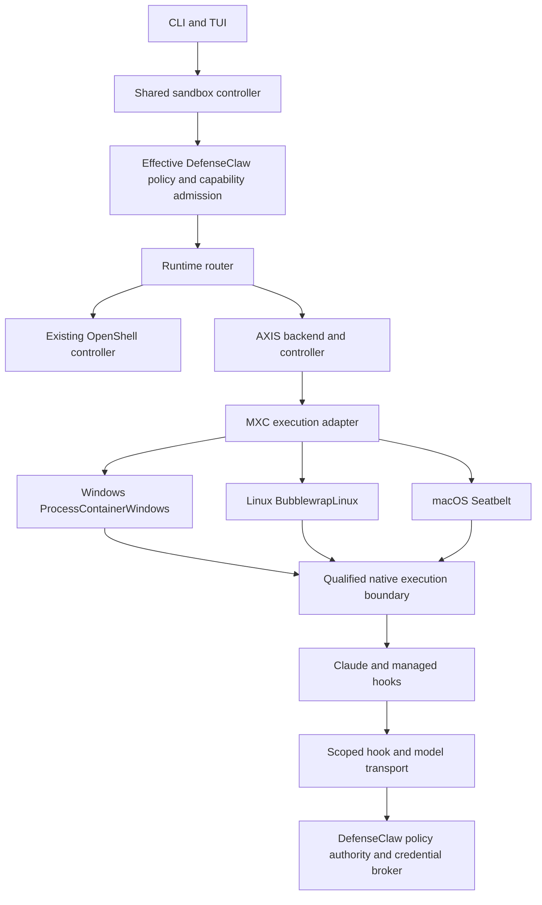

# AXIS sandbox integration plan

Add AXIS as a selectable DefenseClaw sandbox runtime alongside NVIDIA OpenShell.
DefenseClaw owns the command, policy, agent hooks, approvals, workspace review,
credentials, and telemetry; runtime adapters supply the execution boundary.
After selecting AXIS as the default, the customer continues to use
`defenseclaw sandbox run claude`.

Status: implementation draft, October 18, 2026. The single AXIS PR contains this
plan, shared policy/configuration and native boundary work. Current native test
results are recorded in [the manual evidence](../../test/e2e/axis/mxc-v1-manual-results.md)
and [the Windows evidence](../../test/e2e/axis/windows/mxc-v1/manual-results.md).
The run command now accepts `--runtime`; AXIS execution remains unavailable while
its complete policy, hook, credential and agent paths are being qualified.
On Windows, implicit/auto run selection loads the canonical configuration before
OpenShell's platform check, so a configured AXIS default reports its qualification
refusal. Explicit AXIS and OpenShell refusals need no configuration. Other
commands retain their platform-first check. This selection work does not enable
native execution. Managed Windows hosts also retain their platform-first refusal
before per-user configuration or `.env` loading; uncertain or untrusted
installation metadata also refuses that read without becoming managed policy
authority. Their daemon adapter remains unavailable.
The private [backend](../../internal/axis/backend/README.md) now owns held assets,
one-use preparation and launch, canceled preparation, retired session IDs and
independent native cleanup. Its installation catalog and policy compiler remain
closed. The authenticated API has a bounded attachment transport for an already
admitted process; it accepts no launch command or environment. The current
manager does not expose native attachment yet. Latest Linux native outcomes and
their limits are recorded in the [fixed peer evidence](../../test/e2e/axis/native-peer/live/README.md).
The shared host-policy handoff now captures one projected configuration,
resolved evaluator and exact execution requirements for planning and binding,
without rereading pack sources. It refuses stale or changed option binding.
The existing OpenShell manager now carries one owned resolution through initial
policy and provisioning, including image, token and undo settings. The gateway now has an optional native launch owner that pairs the real
published Config/N with one captured run-specific policy. Its reload transaction
revokes first and covers token/v8 changes, configuration/generation publication
and the commit tail; a later first-token writer refuses. Authority also requires
the same process-wide scanner/provider generation and an unchanged resolved
gateway token. An out-of-band change closes native admission. The native controller
factory still does not install it or qualify a runtime. Managed daemons need
their own policy-adoption transaction. Live policy refresh and restart continue
to apply current policy deliberately.
[Claude's review approved starting Stages 1 and 2](https://github.com/cisco-ai-defense/defenseclaw/pull/1307#issuecomment-6243746197).
That approval does not cover merging or releasing AXIS support; later production
stages retain their acceptance gates.

## Baseline and prerequisite

The repository baseline is `main` at
`a6ab014b0ceb4c783e4afafce39fe6e1a76f249b`. AXIS findings below refer to upstream
commit `fb5fd5f0f9377c2ccb30d7e027a36373de0d037c` (Cargo version 0.3.5).
Use these references for review; select and revalidate the shipping AXIS pin
during implementation.

At this baseline, DefenseClaw exposes the sandbox REST API through
[`SandboxController`](../../internal/gateway/api_sandbox.go), constructs the
OpenShell manager in
[`buildSandboxRuntime`](../../internal/gateway/sidecar_sandbox.go), and stores
OpenShell configuration in
[`internal/config/config.go`](../../internal/config/config.go).
Runtime-neutral `sandbox.*` configuration and `--runtime` selection are proposed
behavior in this document, not features present on this baseline.

The development workspace also contains concurrent, unmerged Windows work:
`internal/sandboxruntime/`, common sandbox configuration, a runtime router,
capability admission, and Windows adapters. Before implementation, reconcile
that work with current `main`. Extend its shared abstraction if it lands first;
otherwise land the minimal shared abstraction as a reviewed prerequisite.
Do not introduce a competing runtime framework or fold unrelated Windows changes
into the AXIS work.

Current `main` already supports standalone managed computers through
[`per-user sandbox daemons`](../../internal/gateway/sandbox_daemon_runtime.go),
[`sandbox registrations`](../../internal/sandboxreg/), and
[`policy relays`](../../internal/sandboxrelay/). Preserve that architecture:
the managed gateway remains policy authority, while sandbox execution stays
under the user's account.

## Customer contract

The target commands are design examples. The runtime flag is an implementation
deliverable, not an instruction to run against the baseline release.

```text
defenseclaw sandbox setup --runtime axis
defenseclaw sandbox doctor --runtime axis

# Once the default runtime is configured:
defenseclaw sandbox run claude

# Override the default for a new session:
defenseclaw sandbox run claude --runtime openshell
defenseclaw sandbox run claude --runtime axis
```

Use the common configuration shape from the sandbox abstraction work:

```yaml
sandbox:
  enabled: true
  runtime: axis
  runtimes:
    axis:
      enabled: true
    openshell:
      enabled: true
```

Enabling or installing a runtime does not change the default. Setup offers an
explicit default selection and saves it through the shared configuration writer.
On managed hosts, administrator policy decides which runtimes are enabled and
whether a user can choose between them.

Introduce `sandbox` additively; do not rename or remove `openshell` in this
milestone. When `sandbox` is absent, the supported `openshell` configuration is
the policy source. When present, `sandbox` is the common policy source, while
OpenShell-specific binary, gateway, driver, and image settings remain under
`openshell`. `sandbox.runtimes.openshell.enabled` enables that adapter; it does
not replace the entire existing OpenShell configuration.

There is no load-order precedence for overlapping policy values. Reject
conflicting explicitly configured common values under `openshell` and `sandbox`
with a field-specific error; matching duplicates may be accepted during the
transition. Implicit loader defaults do not count as explicit conflicts.
Administrator restrictions cannot be weakened during normalization. Add the
optional fields to the closed schema and both language mirrors together, using
loader defaults without bumping the configuration version for this pure
addition. Any later removal or relocation of existing keys needs a separately
reviewed schema version and Go migration that preserves the supported
0.8.x-to-1.0.x upgrade chain.

Resolve new sessions in this order: explicit runtime flag, configured default,
then the established host-specific `auto` selection. Existing Linux and macOS
OpenShell installations keep their default and supported legacy configuration.
An unavailable or policy-incompatible selection produces a specific error;
it never switches runtimes or runs the agent uncontained.

Record the creating runtime on each session. Resume, connect, stop, delete,
logs, review, and pull use that recorded identity even after the default changes.
The initial selector should require an explicit new session when the requested
runtime differs from a resumable session; it must not silently migrate it.

## Architecture

Keep the provider contract extensible beyond OpenShell and AXIS. DefenseClaw is
the sole authority for policy, approvals, hooks, credential brokering, workspace
review, telemetry, and control-plane operations. A runtime adapter compiles the
admitted effective policy into its enforcement mechanisms and executes only
owned instances. It does not supply a second customer-editable policy source or
an independent approval/control plane. AXIS proxy and OPA components must remain
subordinate enforcement mechanisms for DefenseClaw's decisions.

The common customer commands and session behavior must survive a provider
change. Keep executor and vendor implementation details out of routine customer
flows; use them in diagnostics and evidence where they explain capabilities.
If a required capability cannot preserve the shared contract, refuse before
launch with a specific reason. Never weaken policy or switch providers to make
the request run.

The requested AXIS integration uses MXC on all three native host platforms:

| Native host | Required MXC executor | Product qualification |
| --- | --- | --- |
| Windows | `ProcessContainerWindows` | Native contained Claude `--version` passed. The environment/boundary handshake still refuses; interactive Claude, hooks and model access remain pending. No WSL dependency or fallback. |
| Linux | `BubblewrapLinux` | The downstream fixed strict filesystem/offline cases and two wait/cancellation cases passed. The descendant test stopped at its own syscall precondition; production policy, broker and Claude qualification remain pending. |
| macOS | `Seatbelt` | Twelve fixed downstream SDK checks passed, including literal arguments, filesystem/network denials, pipes, PTY/resize and timeout. Production policy, broker and Claude qualification remain pending. |

This is the desired support matrix, not a claim that the pinned AXIS artifact
already supplies these routes or that any platform is ready for production.
Qualify each platform independently against the same DefenseClaw security
contract. WSL and AXIS-native execution are not alternate product routes.

The table distinguishes downstream contributor experiments from the pinned
upstream behavior below. The Linux experiment supplies a reviewed held-object
mount adapter and AXIS offline filter; it does not make stock MXC's filesystem
translator suitable for the product unchanged. Exact results and preserved
failures are in the [Linux evidence](../../test/e2e/axis/native-peer/live/README.md),
[Windows evidence](../../test/e2e/axis/windows/mxc-v1/manual-results.md) and
[macOS evidence](../../test/e2e/axis/mxc-macos-manual-results.md).



The diagram represents target ownership, not the pinned AXIS platform dispatch.
In per-user mode the policy authority
is the user's gateway. On standalone managed computers, the per-user sandbox
daemon uses authenticated registration and relays to the managed gateway;
it does not gain an independent policy evaluator or a user-editable policy file.

Keep the current OpenShell manager behind the shared controller initially.
Rewriting its internals into the new backend interface is not a prerequisite.
Keep the public `/api/v1/sandbox/` API and preserve all current operations,
including destinations, discovery, process inspection, and policy testing.
An AXIS operation without a verified implementation reports unsupported while
the same OpenShell operation continues to work.

The proposed backend contract covers discovery, policy admission,
provision/inspect/start/stop/delete, and execution. Terminal transport,
persistent sessions, workspace transfer, policy updates, image building,
credential binding, and MCP support are explicit capabilities.
Capabilities describe tested behavior of a pinned runtime and harness;
an upstream feature name alone is not evidence.

Keep runtime, actual backend/driver, execution OS, and enforcement posture
separate. AXIS process containment must not be described as the same boundary
as an OpenShell container or MicroVM. Record both the AXIS version and selected
underlying backend. A native macOS AXIS launch requires a Darwin harness
contract rather than relabeling it as a Linux workload.

Harness evidence needs a typed immutable identity: an OCI image for existing
container paths or a verified artifact bundle for AXIS process execution.
The bundle identifies the harness, launcher, hooks, managed configuration, and
their digests. Do not manufacture an image digest for a host executable.
Select workspace transport by backend capability rather than by execution OS.

## AXIS compatibility findings

These findings define the initial feasibility gates and the likely upstream
work. They do not establish production certification.

| Area | Behavior at the pinned AXIS commit | Integration consequence |
| --- | --- | --- |
| Launch lifecycle | `axis run` takes different paths depending on whether its daemon answers. The daemon branch waits for Ctrl+C; the standalone branch waits for the child and returns its exit code. | Choose a deterministic supervised execution path. Do not depend on an unrelated user daemon. |
| Terminal | Linux has a PTY bridge, but it opens fixed 24 by 80 geometry without an evident resize protocol. | Prove resize, raw input, signals, prompt interaction, and terminal restoration; contribute upstream support if needed. |
| Environment | The CLI collects a restricted environment, dropping arbitrary `DEFENSECLAW_*` keys and raw provider credentials. | Deliver derived hook configuration through protected files or a reviewed entrypoint/API. Do not rely on inherited variables. |
| Model authentication | Host injection is limited to supported local HTTP inference targets; external HTTPS CONNECT does not provide equivalent credential injection or HTTP path enforcement. | Validate a scoped host model relay, including Anthropic streaming. API-key and OAuth paths need separate acceptance. |
| Filesystem confidentiality | The default filesystem compatibility is `best_effort`. The pinned Linux MXC Bubblewrap translation acknowledges a read-only host-root substrate in that mode and refuses a strict default-deny policy without a root-read grant. | Require `filesystem.compatibility: hard_requirement` without granting read access to `/`. A private HOME is state setup, not proof of read confinement. Resolve the required MXC executor's gap before enabling that platform; do not switch to an alternate backend. |
| Agent state | Recognized home directories can be copied, backed up, and temporarily redirected during preparation. | Give each session a private HOME and sanitized state; do not expose the customer's real Claude state or credential stores. |
| Network | Strict Linux proxy mode requires enforceable namespace/firewall support or the optional privileged helper. | Doctor must probe the requested policy and fail before launch when enforcement is unavailable. Proxy environment variables alone are insufficient. |
| Audit | Standalone execution bypasses daemon lifecycle handling; the proxy constructs an audit log without an evident export sink hookup. | DefenseClaw owns its lifecycle and policy events. Validate AXIS denial-event export before claiming complete runtime audit coverage. |
| Windows | Current native code rejects interactive ConPTY; README and setup descriptions also disagree about the supported launch slice. | Native Windows with MXC ProcessContainerWindows remains a required target, blocked until real interactive and headless Claude pass against exact native artifacts. WSL is not a substitute. |
| macOS | The requested route is AXIS through MXC Seatbelt; an upstream macOS or Seatbelt feature name alone does not verify that route. | Verify the actual dispatcher and qualify lifecycle, terminal, policy, hooks, and model transport on a native macOS host before offering it. |

Pinned upstream sources:

- [CLI launch paths](https://github.com/ROCm/axis/blob/fb5fd5f0f9377c2ccb30d7e027a36373de0d037c/crates/axis-cli/src/main.rs#L681-L892)
- [PTY bridge](https://github.com/ROCm/axis/blob/fb5fd5f0f9377c2ccb30d7e027a36373de0d037c/crates/axis-cli/src/pty_bridge.rs#L13-L95)
- [Environment collection](https://github.com/ROCm/axis/blob/fb5fd5f0f9377c2ccb30d7e027a36373de0d037c/crates/axis-core/src/sandbox_env.rs#L6-L99)
- [Provider inference targets](https://github.com/ROCm/axis/blob/fb5fd5f0f9377c2ccb30d7e027a36373de0d037c/docs/agent-provider-inference-targets.md#L29-L68)
- [Agent state lifecycle](https://github.com/ROCm/axis/blob/fb5fd5f0f9377c2ccb30d7e027a36373de0d037c/docs/agent-state-containment.md#L46-L66)
- [Filesystem compatibility defaults](https://github.com/ROCm/axis/blob/fb5fd5f0f9377c2ccb30d7e027a36373de0d037c/crates/axis-core/src/policy.rs)
- [MXC filesystem substrate and strict refusal](https://github.com/ROCm/axis/blob/fb5fd5f0f9377c2ccb30d7e027a36373de0d037c/crates/axis-sandbox/src/linux/mxc.rs)
- [Linux enforcement prerequisites](https://github.com/ROCm/axis/blob/fb5fd5f0f9377c2ccb30d7e027a36373de0d037c/docs/linux-setup.md)
- [Proxy audit construction](https://github.com/ROCm/axis/blob/fb5fd5f0f9377c2ccb30d7e027a36373de0d037c/crates/axis-proxy/src/proxy.rs#L237-L285)
- [Windows terminal rejection](https://github.com/ROCm/axis/blob/fb5fd5f0f9377c2ccb30d7e027a36373de0d037c/crates/axis-sandbox/src/windows/mxc.rs#L454-L463)

## Policy and credential requirements

Resolve policy once: pack defaults, configuration, supported run overrides,
administrator constraints, then runtime capability admission. Render AXIS
enforcement configuration from that result. Keep AXIS OPA evaluation aligned
with DefenseClaw decisions; it must not become another editable source of policy.
Policy explanation shows runtime-specific clamps and refusals.

Filesystem read confinement is mandatory as well as write confinement. Require
`hard_requirement` compatibility and no host-root read grant. A read-only host
view is not equivalent to an allowlist of readable files. Validate with synthetic
canaries outside the allowed workspace and HOME; never inspect real credentials
to prove the boundary. At the pinned source, the Linux MXC Bubblewrap path cannot
satisfy this policy and must be refused until the gap is resolved. Native Windows
MXC ProcessContainerWindows and macOS MXC Seatbelt require their own live
read-and-write confinement evidence. Earlier `axis_native` experiments are
historical research only, not an alternate integration path or fallback.

Require an enforced network boundary that permits only the scoped services
needed for the session. General web traffic must reach DefenseClaw destination
policy, approvals, blocklists, and SSRF checks. AXIS must not provide a parallel
direct egress path around those decisions. Verify model, hook, web, DNS, and
non-HTTP paths separately. Revocation must close affected ongoing access, not
merely change future connection decisions.

Keep provider credentials on the host. Reuse existing credential, policy, and
relay components where possible, extending their transport rather than adding
another login store. Authenticate and bind model access to the owned session;
validate request destinations and preserve TLS validation upstream. Prove the
declared credential scope, streaming behavior, expiry, rotation, and revocation
before admitting that authentication profile. A session-scoped relay is not
proof of OpenShell's executable-bound credential semantics.

Every upstream hop carrying a provider credential must use HTTPS with validated
TLS and an approved origin. Reject an HTTP target before attaching the
credential. Refuse redirects for credentialed model requests rather than
following them, including cross-origin redirects and HTTPS-to-HTTP downgrades.
Return a bounded, redacted refusal without contacting the redirect target.
Contract tests must prove that a credentialed request redirected to an unapproved
host is rejected with no target connection or credential disclosure, and that
an HTTP destination receives no credential. This rule concerns provider secrets;
the separately authenticated local hook/model channel must not carry those
secrets or expose a general-purpose host proxy.

Initial API-key qualification does not certify Claude subscription/OAuth, AWS
routes, arbitrary `--credential` substitution, or every child executable.
Reject an unsupported selected profile before creating the sandbox, and explain
the supported choices without copying host credentials into the workload.

Reuse the shared connector and guardrail pipeline for every existing hook
connector. Protect hook scripts and managed
settings at the actual containment boundary, use scoped and revocable hook
authentication, and run a hook-fire probe against the exact harness bundle.
Prove allow/block outcomes and resist hostile user/project settings. Keep the
hook path bounded; do not add runtime discovery or credential initialization to
each tool call. AXIS hooks and relays fail closed on errors, timeouts, or an
unreachable policy authority in every offered deployment mode. Secure Client's
separate fail-mode rules do not apply to this preview. Strong permission-bypass
operation requires independent proof
of containment, hook integrity, credential scope, and mandatory egress.

Use copied workspaces initially, with existing secret masks, bounded staging,
snapshot, review, pull, and undo behavior. Reject links and paths that escape the
owned workspace. Keep session HOME and caches separate between concurrent runs.
No stock AXIS agent policy may copy or rewrite the customer's real HOME.
Retain recoverable workspace state when cleanup fails.

## Deployment and installation

AXIS is optional. Disabled AXIS starts no process, listener, timer, watcher,
discovery scan, or helper. Keep its backend and dependencies out of hook binaries.
There is no new model requirement and GPU features are outside the initial scope.

Install only pinned, integrity-verified AXIS artifacts and the required backend
components into trusted installation-owned locations. Resolve executables from
those locations rather than project-controlled PATH entries. Do not download
or install dependencies silently. Any privileged helper, new listener, network
route, or artifact format needs explicit architecture review before code lands.

Document prerequisites by tier: AXIS and its selected executor are Required for
AXIS use; Linux runtime and strict-network prerequisites are Required when that
policy needs them; a privileged helper is Optional when another qualified
enforcement mechanism is available. Doctor reports the actual missing control,
not just whether `axis --version` runs. An AXIS-only installation must not require
the OpenShell gateway, OpenShell CLI, Docker, or OpenShell-specific host aliases.

On standalone managed computers, preserve the existing per-user daemon and
gateway authority split, authenticated peer identity, registrations, policy
generations, egress refresh, telemetry relay, and cross-user privacy. Local
runtime choices and environment variables cannot weaken administrator policy.
Qualify managed AXIS separately; keep it unavailable in deployment modes that
have not passed their own tests, including unsupported Secure Client routes.

## Implementation sequence

Each implementation PR includes every affected layer for its scoped behavior:
schema, Go/Python mirrors, migration when needed, documentation, packaging,
telemetry, and tests. No incomplete runtime is advertised as usable.
This work remains in the single AXIS draft PR; the stages below are work and
acceptance boundaries within it, not a request to open additional product PRs.

| Stage | Deliverable | Acceptance gate |
| --- | --- | --- |
| 1 | Reconcile current main with Windows abstraction work and preserve the complete current controller/API contract. | Review establishes one shared abstraction, managed-mode ownership, backwards compatibility, and prerequisite order. |
| 2 | Build scoped Claude feasibility prototypes against pinned AXIS and the required native MXC executors: Windows ProcessContainerWindows, Linux BubblewrapLinux, and macOS Seatbelt. | Each platform independently proves deterministic lifecycle, real interactive and headless Claude, authenticated hooks, API-key streaming, private HOME, strict filesystem confinement, and strict egress. Any upstream blockers have a concrete resolution. |
| 3 | Add common runtime selection, capability reporting, configuration, routing, and registry identity fields without enabling AXIS. | Existing OpenShell and managed-daemon tests pass; defaults, old records, and configuration round trips remain compatible. The same PR updates `defenseclaw.sandbox.runtime` and `defenseclaw.sandbox.driver`, adds proposed `defenseclaw.sandbox.runtime_version` and `defenseclaw.sandbox.backend`, and generates/tests affected telemetry outputs. |
| 4 | Implement the AXIS backend, supervised I/O, session custody, artifacts, workspace handling, hooks, policy rendering, and scoped model transport. | Backend conformance, negative enforcement, failure cleanup, and crash recovery pass. Only proven capabilities are admitted. |
| 5 | Expose AXIS setup/default selection, doctor, TUI, wrappers, teardown, package detection, and telemetry. | AXIS-only and mixed-runtime workflows work through DefenseClaw. Both CLIs preserve arguments and exit codes; the UI uses reported capabilities. |
| 6 | Qualify the three native platform targets and each offered deployment/authentication combination independently. | Live acceptance evidence identifies the native host, MXC executor, artifact digests, harness version, policy, commands, and results. Support claims match that exact scope; unqualified combinations remain unavailable. |

Stages 1 and 2 precede production adapter design. Stop the AXIS milestone if a
required boundary or interactive transport cannot be established; do not convert
the request into an uncontained host launch or a weaker proxy-only mode.

## Implementation touchpoints

Existing paths below are on the baseline. Proposed package names are subject to
reconciliation with the Windows work.

| Concern | Existing source or proposed change |
| --- | --- |
| Common runtime controller | Extend the reviewed Windows `internal/sandboxruntime/` abstraction, or introduce its minimal reconciled prerequisite. Preserve all methods in `internal/gateway/api_sandbox.go`. |
| AXIS adapter | Proposed `internal/axis/`: discovery, verified artifacts, policy rendering, process/session ownership, terminal and workspace adapters. |
| Configuration | `internal/config/`, `schemas/config/v8/defenseclaw-config.schema.json`, `cli/defenseclaw/config.py`, shared writers and managed settings/relay contracts. Determine hot versus restart-required keys and maintain migration/default parity. |
| Gateway construction | `internal/gateway/sidecar_sandbox.go`, `sandbox_daemon_runtime.go`, `internal/sandboxreg/`, `internal/sandboxrelay/`; construct the selected adapters under the correct user's runtime. |
| CLI | `internal/cli/sandbox.go`, `internal/openshell/sandboxcli/`, `cli/defenseclaw/commands/cmd_sandbox.py`, command manifest; resolve runtime before OpenShell-specific preflight. |
| Agent assets and workspaces | Existing `internal/openshell/harness/`, `image/`, `workspace/`, `packs/`, gateway connector assets, and `internal/sandboxauth/`; extract only the necessary reusable contracts. |
| Operator surfaces | Python doctor/setup/uninstall, TUI launch/state/setup, shell wrappers, and macOS sandbox models where the shared API changes. Remove assumptions that every Unix runtime is OpenShell. |
| Telemetry | Typed runtime/driver identities, lifecycle, policy and refusal events in `internal/audit/` and the telemetry registry. Generate affected outputs and retain redaction and session correlation. |
| Documentation and release | Canonical operator setup/capability pages under `docs-site/content/docs`, CLI/config references, prerequisite tiers, packaging, rollback, and support matrix evidence. |

## Validation and release scope

Run unit and contract tests without an installed AXIS runtime, plus separate
native Windows, Linux, and macOS live suites with real AXIS, the required MXC
executor, and Claude. WSL results do not qualify native Windows. Mocked success does not certify an
isolation boundary. Preserve the repository's normal pre-PR and affected-area
checks for each implementation PR.

| Test group | Required coverage |
| --- | --- |
| Selection and compatibility | Explicit/default/auto selection; disabled or unavailable runtime; legacy OpenShell configuration and records; mixed lists; default changes; resume mismatch; every existing OpenShell API operation. |
| Lifecycle and terminal | Interactive/headless exit status; streams; resize; Ctrl+C/Ctrl+D; terminal restoration; timeout; parent death; descendant cleanup; teardown; concurrency; restart reconciliation. Unsupported persistence/detach modes refuse clearly. |
| Hooks and policy | Each existing hook connector: real hook-fire allow/block probe; hostile settings; tamper/silence detection; authenticated ingress; effective admin clamps; no direct control-API access; unsupported resource policy refused before launch. |
| Credentials and egress | Raw secret absence in guest environment, files, logs, and telemetry; API-key and OAuth independently; Anthropic streaming; expiry/revocation; HTTPS required before credential attachment; credentialed redirects refused, including unapproved-host and downgrade targets, with no target connection or credential disclosure; direct network bypass blocked; DNS/non-HTTP paths; approvals and policy refresh. |
| Workspace and ownership | Private HOME; no real Claude state migration; denied reads of synthetic canaries outside approved paths under hard filesystem compatibility; no host-root read grant; secret masks; copied project review/pull/undo; archive/path safety; two simultaneous sessions; recovery preserving user changes; operations restricted to owned instances. |
| Deployment and UI | AXIS-only installation; both providers installed; disabled runtime has no background cost; missing prerequisites; config save/load and managed controls; correct TUI runtime arguments and action availability; uninstall cleans only owned artifacts. |
| Managed execution | Per-user daemon identity; gateway registration and policy authority; generation/revocation; relay failures; cross-user refusal/privacy; upgrade and rollback against supported prior configurations. |

The requested release scope includes every existing hook connector, with copied workspaces
on native Windows through MXC ProcessContainerWindows, Linux through MXC
BubblewrapLinux, and native macOS through MXC Seatbelt. Each platform needs real
interactive/headless execution and individually qualified authentication and
deployment profiles before it becomes available. No platform is currently
qualified by this plan or its initial prototype. Claude is the first complete
integration case, not the release coverage boundary. Existing OpenShell behavior
remains supported.

The current sandbox harness registry contains Amp, Antigravity, Claude Code,
Codex, Copilot, Cursor, Devin, Hermes, Kiro, Omnigent, OpenCode and OpenHands.
Track each harness against Windows, Linux and macOS using its actual native
availability and versioned hook contract. Reuse `ResolveHookContract`,
`RenderSandbox`, authenticated sandbox ingress, and the manager's hook decision,
tamper and silence handling. Kiro's adapter remains part of this inventory;
proxy-only integrations must retain their existing route rather than being
reported as hook connectors. New providers must not require changes to agent
hook semantics. An unavailable native agent distribution is an explicit matrix
gap, never a passing result or host fallback.

For every offered connector/platform pair, require an actual contained agent
session, allow/block decisions, hostile project/user settings, protected hook
assets, timeout and authority-loss behavior, session isolation and owned cleanup.
Headless, interactive and provider-authentication profiles require separate
evidence where their behavior differs. Shared contract tests cover all registry
entries, while native manual tests qualify the real agent and OS boundary.

WSL and alternate AXIS-native backends are outside this integration route.
Live mounts, GPU/VM backends, MCP import, executable-bound
generic credentials, learn mode, and persistent attach need separate accepted
scope and qualification. Unsupported features and unqualified platform routes
are visible refusals, not silently ignored settings or fallback execution.

## Review decisions

### Research update: MXC API and the replaceable execution layer

The October 18 follow-up requires implementation and adversarial/manual testing
of the three native routes, with DefenseClaw behavior preserved across future
providers. The original Linux-only feasibility scope is superseded by the
platform matrix above. Qualification gates still apply to every offered mode.

Two upstream versions must be kept distinct:

- AXIS remains pinned at `fb5fd5f0f9377c2ccb30d7e027a36373de0d037c`, reporting
  0.3.5. Its Windows packaging pairs Microsoft MXC
  `1736b48398c3fe4d1315b2311c0951cc893eb3ae` with three AXIS patches. See the
  [paired dependency contract](https://github.com/ROCm/axis/blob/fb5fd5f0f9377c2ccb30d7e027a36373de0d037c/third_party/mxc/README.md).
- Current MXC research is pinned independently at
  `fda29ac63bc306b7f97f3b86b4b63d44f7f40cf2`, SDK 1.0.1. Its supported V1 API
  has typed containment requests, live pipes, structured wait outcomes, and
  terminal handles. Native JSON contract versions and SDK versions are separate;
  replacing AXIS's executor with this build without updating its translator is
  not a compatible upgrade. See the
  [V1 execution API](https://github.com/microsoft/mxc/blob/fda29ac63bc306b7f97f3b86b4b63d44f7f40cf2/docs/api-reference/rust/v1/api.md)
  and [versioning model](https://github.com/microsoft/mxc/blob/fda29ac63bc306b7f97f3b86b4b63d44f7f40cf2/docs/development/architecture/versioning.md).

The proposed implementation boundary is a small native execution bridge beneath
the common Go controller. Keep admitted policy, session ownership, authentication,
approvals, workspace review, hook dispatch, and model credentials in DefenseClaw.
The bridge translates an immutable effective-policy snapshot, launches the
selected MXC substrate, and exposes bounded streams, terminal control, wait,
termination, and structured enforcement errors. A Rust bridge can reuse AXIS
policy guards and the supported MXC SDK without making AXIS's CLI output or
daemon into DefenseClaw's protocol. This is a design inference from the APIs,
subject to the prototypes below; it is not a claim that stock AXIS provides it.

The common contract must include a policy generation/digest, exact composite
artifact identity, owner and session identity, literal argv, explicit replacement
environment, private working/state directories, required capabilities, and
bounded deadlines/output. The adapter must report a plan for every requested
policy surface: exact enforcement, an explicit required host dependency, or
unsupported. A customer cannot supply capability evidence. Unsupported required
semantics prevent execution; adapter defaults must not expand admitted access.

Concrete integration work established by source review:

| Surface | Current evidence | Implementation consequence |
| --- | --- | --- |
| Windows process isolation | AXIS's MXC adapter contains a real native launch path despite stale blanket refusal prose elsewhere. | Test the paired native artifacts on the actual host; do not infer availability from either README wording or API export presence. |
| Windows terminal | AXIS refuses interactive MXC; current MXC's native ProcessContainer adapter also rejects caller-controlled PTY. The Node SDK uses an outer ConPTY/executor topology. | Prototype an explicit inherited-console mode retaining the interactive request and all containment checks; prove input, resize, signals, exit and cleanup before Claude. [Native SDK admission](https://github.com/microsoft/mxc/blob/fda29ac63bc306b7f97f3b86b4b63d44f7f40cf2/src/mxc-sdk/src/backends/process_container/common/mod.rs#L58-L68), [Node transport](https://github.com/microsoft/mxc/blob/fda29ac63bc306b7f97f3b86b4b63d44f7f40cf2/sdk/node/src/bindings/process-container-pty.ts#L140-L181). |
| Linux streams and terminal | New MXC V1 exposes typed pipe/PTY handles, including resize and structured timeout outcomes. | Use the supported handles, then add AXIS child guards needed to meet the exact admitted filesystem and syscall policy. Independently test Bubblewrap confinement and each added guard. [API and tests](https://github.com/microsoft/mxc/blob/fda29ac63bc306b7f97f3b86b4b63d44f7f40cf2/src/mxc-sdk/tests/streaming_bubblewrap.rs). |
| macOS MXC | AXIS rejects MXC selection on macOS; its current implementation directly launches its own Seatbelt profile. | Add an explicit reviewed MXC Seatbelt route and qualify it. Sharing Seatbelt as an OS primitive does not establish identical policy or lifecycle behavior. [AXIS dispatch](https://github.com/ROCm/axis/blob/fb5fd5f0f9377c2ccb30d7e027a36373de0d037c/crates/axis-sandbox/src/sandbox.rs#L678-L834). |
| Shared policy authority | AXIS has policy/proxy/inference components in addition to process isolation. | Compile DefenseClaw's resolved policy once. Do not expose independent AXIS policy files, inference selection, credential storage, or approval decisions as a second authority. |

Use the same conformance suite for every provider: denied reads/writes, allowed
workspace operations, network bypass attempts, hook failure/revocation,
credential confinement, session ownership, approval effects, terminal behavior,
timeouts, parent death, teardown, restart/recovery, and workspace review. Run
real Claude separately after the benign confinement/transport tests pass.
Capture exact native host, runtime/bridge/executor hashes, policy and harness
identity, commands, and observed outcomes. Upstream tests and synthetic adapter
fixtures inform the design but do not replace DefenseClaw acceptance evidence.

Claude's review should resolve these design decisions before implementation:

1. Is the shared abstraction reconciled with current main and the Windows work,
   including managed daemon ownership and every current API operation?
2. Which deterministic AXIS launch/API path meets lifecycle and terminal needs,
   and which changes belong upstream rather than in a local workaround?
3. Can the hook and model transports preserve the required authentication,
   credential scope, streaming, revocation, and network boundary?
4. Is artifact-bundle verification sufficient for immutable Claude hooks and
   configuration without weakening existing image evidence?
5. Are initial platforms, deployment modes, authentication profiles, and
   unsupported capabilities explicit enough for accurate customer claims?
6. Which upstream changes are needed for the required native MXC executors to
   enforce strict read confinement and the full terminal/lifecycle contract?
   The stock pinned Linux MXC Bubblewrap translator is incompatible with the
   filesystem requirement. The downstream fixed peer has since passed the
   bounded strict filesystem/offline cases, but its held-object adapter and
   policy translation still require production qualification. Independently verify Windows
   ProcessContainerWindows and macOS Seatbelt without weakening policy,
   changing backends, or substituting WSL to make a feasibility probe pass.

Record the review outcome and any amendments on this draft PR. A positive
review authorizes starting the implementation sequence; it does not certify
AXIS or authorize merging or releasing unverified runtime support.
